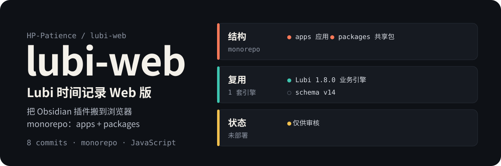
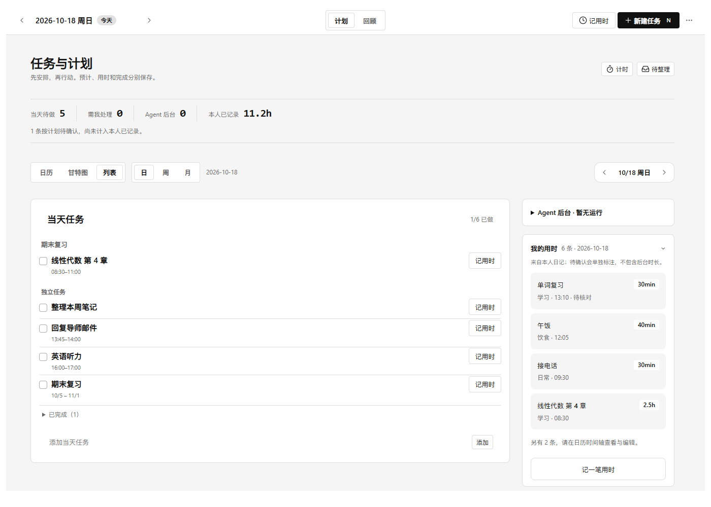
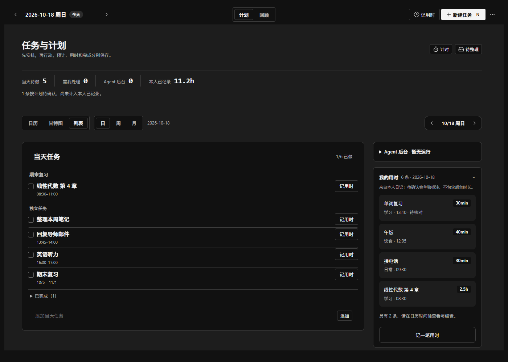
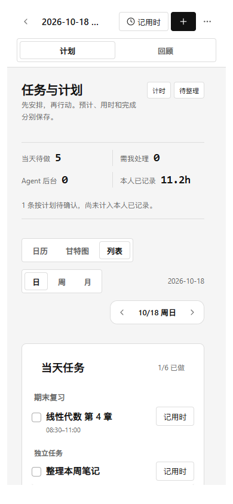
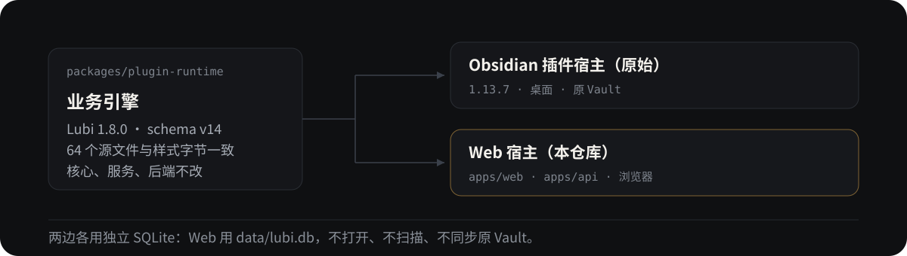

<p align="center">
  
</p>

<p align="center">
  <strong>把 Lubi（柳比歇夫时间记录）的 Obsidian 插件搬到浏览器，业务引擎与 schema v14 一行不改。</strong><br>
  同一份 Markdown 时间轴换一个宿主运行：计划、计时、回顾、备份都在网页里，数据留在本机 SQLite。
</p>

<p align="center">
  <a href="https://github.com/HP-Patience/lubi-web"></a>
  <a href="https://github.com/HP-Patience/lubi-web/commits"></a>
  <a href="#本地跑起来"></a>
  <a href="package.json"></a>
  <a href="docs/架构与数据安全.md"></a>
</p>

> **仅供审核（Phase B），尚未部署。** 基线是已运行的 `a6c02ea`；分支 `ui/cognitive-cleanup-review-20261018`。界面按获准清单简化（布局、折叠、表单顺序、入口位置），功能、数据语义、安全边界与原插件参考不变。没有合并 main、没有替换正式版、没有连接你的服务器。

## 先看实际界面

同数据、同时间、同视窗的真实浏览器截图，合成数据，不含密码或笔记。可离线放大对比：[前后截图](docs/Web界面对照.html)。

<p align="center">
  
</p>

<p align="center">
  
  
</p>

## 一套引擎，两个宿主

<p align="center">
  
</p>

- **只换宿主**：`apps/web` 负责界面，`apps/api` 负责本地服务与 SQLite，业务模型仍来自 `packages/plugin-runtime`。
- **不改上游**：`UPSTREAM.json` 与原始哈希未改写——64 个源文件与样式字节一致，7 个 UI 文件按 `WEB_UI.json` 显式归 Web 管理，另加 1 个纯表单布局模块。核心、服务、原始样式与后端代码未改。
- **不碰 Vault**：Web 有自己的数据库，不打开、不扫描、不同步原 Obsidian Vault。

## 本地跑起来

### 合成演示（推荐审核入口）

```sh
npm ci
npm run build
npm run preview:review
```

打开 `http://127.0.0.1:4175`。每次启动新建临时 SQLite，不读取 `.env.local`、真实数据库、密钥或 Vault；启动时按上海日期生成样例，必要时点顶部“演示日期”。Ctrl+C 清理临时服务和数据。

**不要输入真实数据或密钥，也不要把这个演示命令当成生产部署命令。** 生产认证、CSP、来源校验与安全配置没有放宽。完整 AI / 命名密钥流程由隔离模拟接口回归验证，不产生真实费用。

<details>
<summary>演示代理的边界</summary>

- 默认监听 `0.0.0.0`，用于平台的嵌入预览；仅本机审核可设 `LUBI_REVIEW_HOST=127.0.0.1`。
- 演示代理只为自己的临时库提供会话，允许嵌入审核。
- 外网 AI 请求与密钥写入禁用；其他非 AI 流程可以实际操作。

</details>

### 正式使用（Windows 启动入口）

双击 **`启动 Lubi.cmd`**，需要 Node.js **24+**。首次按锁文件安装依赖、生成独有的 `.env.local` 访问密码，再构建并启动；浏览器自动打开 `http://127.0.0.1:3000`。密码显示在启动窗口，也保存在 `.env.local`——请勿分享或提交。

- 保持启动窗口运行，Ctrl+C 停止；数据不随关闭浏览器或服务重启丢失。
- 不占用已在使用的端口；如有冲突，在 `.env.local` 设置其他 `PORT` 后重启。

```sh
npm ci
npm run setup
npm run build
npm start
```

开发模式：`npm run dev` 同时管理 API 与 Vite，默认 `http://127.0.0.1:5173`；独立调试可用 `npm run dev:api` / `npm run dev:web`。浏览器始终使用相对 `/api`，不连接浏览器自己的 localhost 后端。

## 功能入口

| 区域 | 内容 |
|---|---|
| 计划 | 列表／日历／甘特图 × 日／周／月；共享日期、范围导航、项目／旧父任务分组、未安排、排序、拖动／伸缩与撤销 |
| 任务与实际 | 默认三项渐进新建；地点、备注、预计、重复／跨度、逐次完成／跳过、实际用时与预计快照、跨午夜拆分、待确认处理、支出。完成／验收不会凭空生成实际记录 |
| 后台任务 | Agent 手动运行 → 待审核 → 验收／返工；后台墙钟与本人投入分开。与原插件一样，这些按钮不真正启动或控制 Agent |
| 回顾 | 周／月／年统计、趋势、分类／事项／支出明细，图表与表格 |
| 命令 | Ctrl / ⌘ + P 搜索并执行原插件注册的 13 个命令；也可从设置打开命令面板，不丢失下层表单草稿 |
| 顶部 | 新建任务与明确的记用时；JSON 任务导入、AI 草稿确认创建位于“更多” |
| 更多 | 设置（插件设置、Web 主题、文件查看／编辑、服务端加密密钥库、退出登录）、备份与恢复 |

计划旁是计时与待整理（批量改期、撤销、拆分）；回顾旁是投入与成果、周复盘与行动；恢复集中在备份中心。实时计时仍可暂停、重启续接和确认入账。原键盘快捷键、悬停提示、明暗与窄屏布局保留。

## 数据边界

- 默认数据库 `data/lubi.db`；配置优先级：系统环境变量 > `.env.local` > `.env`。旧版 `apps/api/data/lubi.db` 若仍存在会被识别保留；有两个候选库时拒绝猜测，需明确设置绝对 `LUBI_DB_PATH`。
- 检测到旧 Web 表且新 Vault 为空时，登录后需明确确认升级；转换有事务备份并保留旧表。完整模式启用后旧写 API 冻结，旧只读导出保留。
- v14 JSON 与 Markdown 按原始文本保存，未知字段与日记非记录章节不被投影丢弃。
- 文件与设置写入带版本检查：并发修改报冲突而不是覆盖；错误或重新登录保留表单草稿；原始文件编辑器保留未保存文本并提示离开。
- 数据恢复默认写到**新隔离目录**，不覆盖活动文件。原插件完整导出 `lubi-data v1` 在「备份与恢复 → 恢复业务数据」导入；检查恢复说明后，可在原设置里切换任务文件与日记目录。
- 虚拟路径必须是相对路径，不接受绝对路径、`..`、隐藏路径或系统盘路径。单文件上限 4MiB，Web 文件备份上限 25MiB；更大工作区用下面的 SQLite 备份。

## 三类备份不要混淆

| 入口 | 内容 | 恢复方式 |
|---|---|---|
| 备份与恢复 → 导出数据 JSON | 原 `lubi-data v1`，v14 TaskStore 与可解析记录；不含设置、密钥和日记其他正文 | 备份与恢复 → 恢复业务数据，写入新隔离目录 |
| 备份与恢复 → 下载 Web 文件备份 | 全部虚拟文本文件，含日记其他正文；不含设置、计时会话、密钥、删除历史 | 备份与恢复 → 恢复 Web 文件备份，校验后复制到新隔离目录 |
| `npm run backup` | SQLite 一致性在线备份：全部文件、设置、历史和加密密钥条目 | `npm run restore:db -- 备份目录 [新目录]`，校验 SHA-256 与 SQLite 完整性，不替换现用库 |

SQLite 备份默认放在被 Git 忽略的 `backups/`。若使用 `LUBI_SECRET_KEY` 环境密钥，备份不会导出它，必须另行安全保管。恢复命令只生成新目录，不改 `.env.local`；检查后再切换数据库与密钥路径。备份可能含个人数据及解密密钥，**不要提交、公开或分享**。

## AI 与命名密钥

AI 沿用原插件的兼容接口、模型获取、测试与确认草稿流程，只在主动操作时请求。

- 临时 API Key 仅在当前页面会话中使用，不写入设置或导出。
- 「钥匙串」在 Web 中对应**独立服务端密钥库**，不是 Obsidian 的系统钥匙串。命名密钥以 AES-256-GCM 加密保存在 SQLite，主密钥默认在数据库旁的 `lubi-credentials.key`；请求时由后端解密，已有密钥不回传浏览器。
- 本机 Ollama 等服务需显式设置 `LUBI_ALLOW_LOCAL_AI=1` 后重启；「本机」指后端所在电脑，不是另一部手机。
- 远程接口必须 HTTPS：禁止跳过证书、内网／特殊地址和任意 URL 代理；只有已保存的 AI origin 与公开版本查询可访问，且不跟随跳转。
- 不填真实密钥也能运行全部非 AI 功能。测试使用本地模拟接口，从不请求真实模型或使用真实凭据。

## 开发入口

| 路径 | 职责 |
|---|---|
| `packages/plugin-runtime/src` | 当前业务与声明的 Web UI；UI 归属见 `WEB_UI.json`，不要在宿主另写任务模型 |
| `apps/web/src/main.ts` | 浏览器入口；`host/obsidian.ts` 是稳定兼容出口，具体能力按职责分模块 |
| `apps/api/src/server.ts` | 服务组合入口；认证与静态服务在 `http/`，旧 SQL 路由在 `legacy/` |
| `@lubi/legacy-domain` | 旧模型包，只服务兼容接口，不是当前 v14 核心 |

模块职责、安全顺序与不变量见 [架构与数据安全](docs/架构与数据安全.md)。

## 验证

```sh
npm run verify          # 归属与验收清单、结构、构建、旧回归、Vault、安全、备份、core/smoke、host、浏览器与专项
npm run test:layout     # 50 个当前 Web 布局场景，不是原版像素对比
npm run test:ui-review  # 单独运行 15 组第二阶段专项
```

Windows 最终候选完整回归、50 场景布局及 7 场景 after 截图均为 exit 0；浏览器工作流 22/22、专项 15/15、core 4/4、Web smoke 19/19，未捕获浏览器错误为 0。测试只使用临时 SQLite、合成数据和模拟 AI，原有工作区与正式数据库未用于测试。

7 个 smoke 文件仅调整获准的 UI 入口／呈现断言，业务断言保留；旧／新哈希与原因见 `test/ui-acceptance-manifest.json`。浏览器测试优先使用本机 Chrome/Edge，也可设置 `LUBI_BROWSER` 或运行 `npx playwright install chromium`；Linux 可能还需 Playwright 系统依赖。

`test:native`、原版参考页生成和 `test:layout:baseline` 在本改版分支**明确拒绝**：它们只适用于未改原 UI 的基线，不能把当前 Web 渲染冒称原版。完整边界、日志位置与截图测量见 [验收记录](docs/验收记录.md)。窄屏浏览器通过不等于真实手机验收。

## 宿主差异

核心功能仍复用原实现，本审核分支的 UI 按明确清单简化。Web 不是 Obsidian 本身：原 Vault、系统钥匙串、桌面文件安装器不与网页共享；日记与成果内链打开 Web 文件编辑器，导出触发浏览器下载。桌面插件更新仍应在 Obsidian 中操作；自定义 Obsidian 主题、第三方插件和原生移动客户端不在网页宿主中运行。

## 历史正式版（Phase A，仍在运行）

以下只描述 `a6c02ea` 正式版，不描述本审核分支。它已在 `E:\项目管理\lubi前后端项目` 通过正常 Windows 启动入口运行，访问 **http://127.0.0.1:3000**；密码在启动窗口与 `.env.local`，不要分享。

- 原插件 71 份源码／样式字节一致；Windows 完整构建与回归、22 项浏览器检查、原布局 13 项全部通过。
- 真实 Obsidian 1.13.7 与 Web 的九视图、浅／深色任务表单等 **12 组对照通过**，尺寸与文字一致，最大检测差异 **0.6205%**；两端真实创建、持久化与完成均已验证。
- 原 Web 的 3 任务、2 项目、2 记录已保留并升级到 v14，原表指纹不变，另有改造前与升级前备份；没有导入或改动原 Obsidian Vault。

历史截图与证据：[`docs/界面对照.html`](docs/界面对照.html)、[`docs/验收记录.md`](docs/验收记录.md)。截图使用合成数据，不含密码或笔记。

## 文档

| 想了解 | 从哪里开始 |
|---|---|
| 本轮四项变化、数据边界、源码归属与验收契约 | [Web 界面审核](docs/Web界面审核.md) |
| 模块职责、宿主适配、数据如何保护 | [架构与数据安全](docs/架构与数据安全.md) |
| 哪些测试实际通过、有哪些已知边界 | [验收记录](docs/验收记录.md) |
| 全部文档与历史阶段材料 | [文档索引](docs/README.md) |
